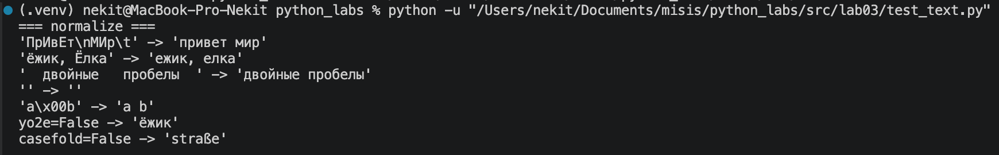
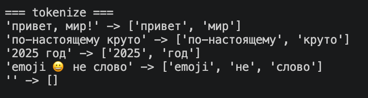
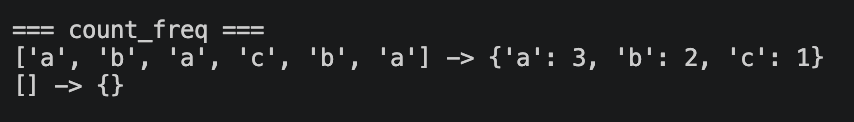
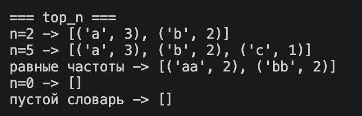
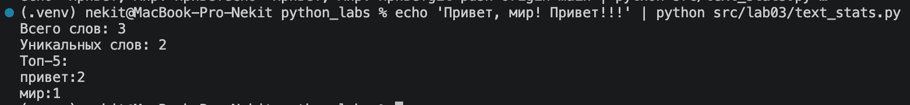
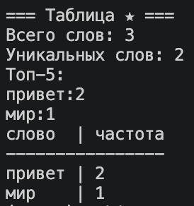

# python_labs

# Хохлов Никита

---

# Группа БИВТ-26-6-1

---

# Лабораторная работа №3

---

В работе используются строки, списки, словари и регулярные выражения.

Реализованы нормализация текста, токенизация, подсчёт частот слов и сортировка результатов.

---

## 1 Задание

### `normalize`

Приводит текст к нижнему регистру, заменяет `ё` на `е`, управляющие символы на пробелы и удаляет лишние пробелы.

```python
def normalize(text: str, *, casefold: bool = True, yo2e: bool = True) -> str:
    """Приводит текст к нижнему регистру и убирает лишние пробелы."""
    if casefold:
        text = text.casefold()
    else:
        text = text.lower()

    if yo2e:
        text = text.replace("ё", "е").replace("Ё", "Е")

    text = "".join(" " if ord(c) < 32 or ord(c) == 127 else c for c in text)
    return " ".join(text.split())
```

### Тестирование `normalize`



---

### `tokenize`

Разбивает текст на отдельные слова с помощью регулярного выражения.

Поддерживает буквы, цифры, нижнее подчёркивание и слова с внутренним дефисом.

```python
import re

def tokenize(text: str) -> list[str]:
    """Находит слова, в том числе слова с внутренним дефисом."""
    return re.findall(r"\w+(?:-\w+)*", text)
```

### Тестирование `tokenize`



---

### `count_freq`

Подсчитывает количество повторений каждого слова в списке.

Возвращает словарь, где ключ — слово, а значение — количество его повторений.

```python
def count_freq(tokens: list[str]) -> dict[str, int]:
    """Считает количество появлений каждого слова."""
    freq = {}

    for word in tokens:
        if word in freq:
            freq[word] += 1
        else:
            freq[word] = 1

    return freq
```

### Тестирование `count_freq`



---

### `top_n`

Возвращает список из N наиболее часто встречающихся слов.

Сортировка выполняется по убыванию частоты, а при одинаковой частоте — по алфавиту.

```python
def top_n(freq: dict[str, int], n: int = 5) -> list[tuple[str, int]]:
    """Сортирует по частоте по убыванию, затем по слову по алфавиту."""
    return sorted(freq.items(), key=lambda x: (-x[1], x[0]))[:max(0, n)]
```

### Тестирование `top_n`



---

## 2 Задание

### `text_stats`

Получает текст от пользователя и выводит общее количество слов, число уникальных слов и пять самых частых слов.

Для обработки используются функции из `lib/text.py`.

```python
def main() -> None:
    text = input()
    words = tokenize(normalize(text))
    freq = count_freq(words)

    print("Всего слов:", len(words))
    print("Уникальных слов:", len(freq))
    print("Топ-5:")

    top = top_n(freq, 5)

    for word, count in top:
        print(f"{word}:{count}")
```

### Тестирование `text_stats`



---

### Задание со звёздочкой ★

Дополнительно реализован вывод частот слов в виде таблицы с автоматическим выравниванием столбцов.

Для включения используется переменная `TABLE_MODE = True`.

```python
if TABLE_MODE:
    width = max([len("слово")] + [len(word) for word, count in top])

    print(f"{'слово':<{width}} | частота")
    print("-" * (width + 10))

    for word, count in top:
        print(f"{word:<{width}} | {count}")
```

### Тестирование задания ★


