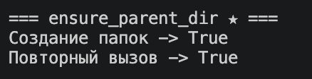
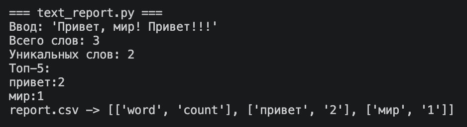
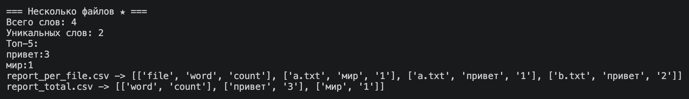
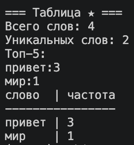

# python_labs

# Хохлов Никита

---

# Группа БИВТ-26-6-1

---

# Лабораторная работа №4

---

В работе используются текстовые файлы TXT, таблицы CSV и функции обработки текста из третьей лабораторной.

Реализованы чтение текстовых файлов, запись CSV-отчётов и обработка нескольких файлов.

Особенности:
- чтение файлов в кодировках UTF-8 и CP1251;
- запись данных в CSV;
- проверка количества столбцов;
- создание родительских папок;
- подсчёт частот слов;
- формирование отдельных и общих отчётов.

---

## 1 Задание

### `read_text`

Читает содержимое текстового файла и возвращает строку.

По умолчанию используется кодировка UTF-8. Также поддерживается чтение файлов в других кодировках.

```python
def read_text(path: str | Path, encoding: str = "utf-8") -> str:
    """Читает содержимое текстового файла."""
    return Path(path).read_text(encoding=encoding)
```

### Тестирование `read_text`


---

### `write_csv`

Записывает список строк в CSV-файл.

При необходимости добавляет заголовок и проверяет, чтобы все строки содержали одинаковое количество столбцов.

```python
def write_csv(
    rows: list[tuple | list],
    path: str | Path,
    header: tuple[str, ...] | None = None
) -> None:
    """Записывает CSV и проверяет одинаковое количество столбцов."""

    if header is not None:
        width = len(header)
    elif rows:
        width = len(rows[0])
    else:
        width = None

    for row in rows:
        if width is not None and len(row) != width:
            raise ValueError("Все строки должны иметь одинаковое число столбцов")

    ensure_parent_dir(path)

    with Path(path).open("w", newline="", encoding="utf-8") as file:
        writer = csv.writer(file)

        if header is not None:
            writer.writerow(header)

        writer.writerows(rows)
```

### Тестирование `write_csv`


---

### `ensure_parent_dir` ★

Создаёт родительские папки для указанного пути, если они отсутствуют.

Повторный вызов функции не вызывает ошибку, если папки уже существуют.

```python
def ensure_parent_dir(path: str | Path) -> None:
    """Создаёт родительские папки для файла, если их нет."""
    Path(path).parent.mkdir(parents=True, exist_ok=True)
```

### Тестирование `ensure_parent_dir`



---

## 2 Задание

### `text_report`

Читает текст из TXT-файла, нормализует его, разбивает на слова и подсчитывает частоты.

Результаты сохраняются в CSV-файл, а в консоль выводятся количество всех слов, уникальных слов и топ-5.

```python
def main() -> None:
    files = STAR_FILES if STAR_MODE else [INPUT_FILE]

    total_freq = {}
    per_file_rows = []
    total_words = 0

    for path in files:
        text = read_text(path, encoding=ENCODING)
        words = tokenize(normalize(text))
        freq = count_freq(words)

        total_words += len(words)

        for word, count in freq.items():
            total_freq[word] = total_freq.get(word, 0) + count
            per_file_rows.append((path.name, word, count))

    if STAR_MODE:
        per_file_rows.sort(
            key=lambda row: (row[0], -row[2], row[1])
        )

        write_csv(
            per_file_rows,
            ROOT / "data" / "report_per_file.csv",
            header=("file", "word", "count")
        )

        write_csv(
            top_n(total_freq, len(total_freq)),
            ROOT / "data" / "report_total.csv",
            header=("word", "count")
        )

    else:
        write_csv(
            top_n(total_freq, len(total_freq)),
            ROOT / "data" / "report.csv",
            header=("word", "count")
        )

    print("Всего слов:", total_words)
    print("Уникальных слов:", len(total_freq))
    print("Топ-5:")

    for word, count in top_n(total_freq, 5):
        print(f"{word}:{count}")

    if TABLE_MODE:
        rows = top_n(total_freq, len(total_freq))

        width = max(
            [len("слово")] + [len(word) for word, count in rows]
        )

        print(f"{'слово':<{width}} | частота")
        print("-" * (width + 10))

        for word, count in rows:
            print(f"{word:<{width}} | {count}")
```

### Тестирование `text_report`



---

### Задание со звёздочкой ★

Реализована обработка нескольких текстовых файлов.

Для включения используется переменная `STAR_MODE = True`.

Программа формирует два CSV-отчёта:

- `report_per_file.csv` — частоты слов отдельно для каждого файла;
- `report_total.csv` — суммарные частоты слов по всем файлам.

```python
STAR_MODE = True

STAR_FILES = [
    ROOT / "data" / "a.txt",
    ROOT / "data" / "b.txt"
]
```

Сортировка результатов для отдельных файлов:

```python
per_file_rows.sort(
    key=lambda row: (row[0], -row[2], row[1])
)
```

Запись отчётов:

```python
write_csv(
    per_file_rows,
    ROOT / "data" / "report_per_file.csv",
    header=("file", "word", "count")
)

write_csv(
    top_n(total_freq, len(total_freq)),
    ROOT / "data" / "report_total.csv",
    header=("word", "count")
)
```

### Тестирование обработки нескольких файлов ★



---

### Табличный вывод ★

Дополнительно реализован вывод частот слов в виде таблицы с выравниванием столбцов.

Для включения используется переменная `TABLE_MODE = True`.

```python
if TABLE_MODE:
    rows = top_n(total_freq, len(total_freq))

    width = max(
        [len("слово")] + [len(word) for word, count in rows]
    )

    print(f"{'слово':<{width}} | частота")
    print("-" * (width + 10))

    for word, count in rows:
        print(f"{word:<{width}} | {count}")
```

### Тестирование табличного вывода ★


