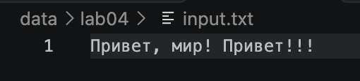
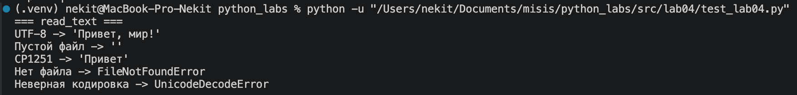
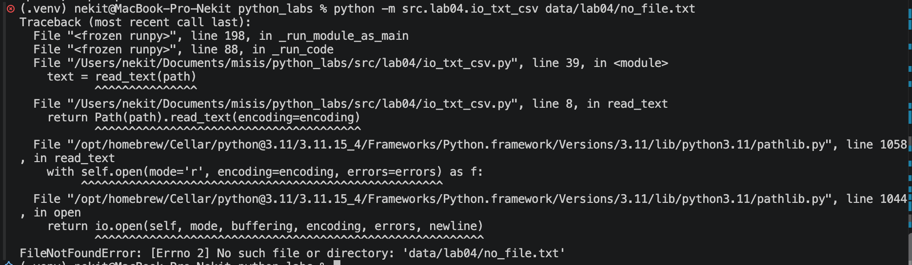
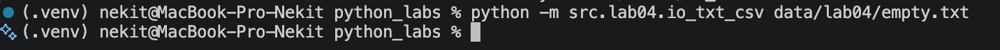
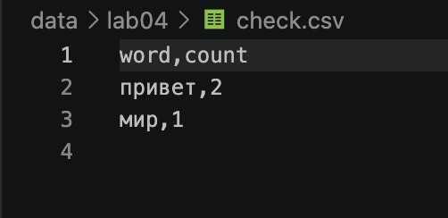
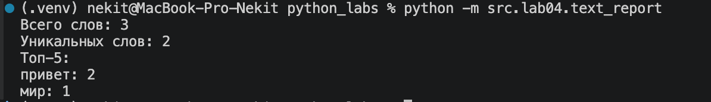
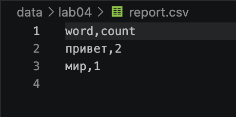
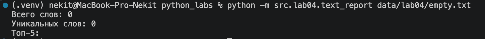
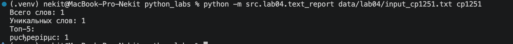

# python_labs

# Хохлов Никита

---

# Группа БИВТ-26-6-1

---

# Лабораторная работа №4

---

В работе используются текстовые файлы TXT, таблицы CSV и функции обработки текста из лабораторной работы №3.

Программа читает текстовый файл, подсчитывает частоту слов и сохраняет результат в CSV.

---

## Запуск программы

Все команды выполняются из корневой папки проекта.

Для запуска используется `python -m`, который позволяет запускать файлы как модули Python.

**1. Запуск первого задания:**

```bash
python -m src.lab04.io_txt_csv
```

Программа читает `input.txt` и создаёт файл `check.csv`.

**2. Запуск второго задания:**

```bash
python -m src.lab04.text_report
```

Программа использует файл `data/lab04/input.txt` с кодировкой UTF-8 и создаёт отчёт `report.csv`.

**3. Запуск с указанием другого файла:**

```bash
python -m src.lab04.text_report data/lab04/input.txt
```

**4. Запуск с другой кодировкой (CP1251):**

```bash
python -m src.lab04.text_report data/lab04/input_cp1251.txt cp1251
```

### Аргументы командной строки

Для передачи пути и кодировки используется `sys.argv`.

- `sys.argv[0]` — путь к запускаемому скрипту.
- `sys.argv[1]` — путь к входному файлу.
- `sys.argv[2]` — кодировка файла.

Если аргументы не указаны, используются `data/lab04/input.txt` и кодировка `utf-8`.

---

## 1 Задание

### `read_text`

Читает текст из TXT-файла и возвращает его содержимое в виде строки.

По умолчанию используется кодировка UTF-8.

```python
def read_text(path: str | Path, encoding: str = "utf-8") -> str:
    """Читает текст из файла."""
    p = Path(path)
    return p.read_text(encoding=encoding)
```

### Исходный файл `input.txt`



### Тестирование `read_text`



---

### Проверка отсутствующего файла

Если файл не существует, возникает `FileNotFoundError`.



---

### Проверка пустого файла

Если файл пустой, функция возвращает пустую строку.



---

### `write_csv`

Записывает данные в CSV-файл.

Проверяет одинаковую длину строк. Если длина отличается, вызывается `ValueError`.

```python
def write_csv(rows: list[tuple | list], path: str | Path,
              header: tuple[str, ...] | None = None) -> None:
    """Записывает данные в CSV."""
    if rows:
        length = len(rows[0])

        for row in rows:
            if len(row) != length:
                raise ValueError("Строки разной длины")

        if header is not None and len(header) != length:
            raise ValueError("Длина заголовка не совпадает с длиной строк")

    file = Path(path)
    file.parent.mkdir(parents=True, exist_ok=True)

    with file.open("w", newline="", encoding="utf-8") as f:
        w = csv.writer(f)

        if header is not None:
            w.writerow(header)

        w.writerows(rows)
```

### Тестирование `write_csv`

В результате работы создаётся файл `check.csv`.



---

## 2 Задание

### `main`

Основная функция программы.

Читает TXT-файл, обрабатывает слова с помощью функций из лабораторной работы №3, подсчитывает их частоту и сохраняет CSV-отчёт.

Выводит общее количество слов, количество уникальных слов и топ-5.

```python
def main():
    """Считает частоту слов и сохраняет CSV-отчёт."""
    path = sys.argv[1] if len(sys.argv) > 1 else "data/lab04/input.txt"
    encoding = sys.argv[2] if len(sys.argv) > 2 else "utf-8"

    text = read_text(path, encoding)

    words = tokenize(normalize(text))
    freq = count_freq(words)

    rows = sorted(freq.items(), key=lambda x: (-x[1], x[0]))

    write_csv(rows, "data/lab04/report.csv", ("word", "count"))

    print(f"Всего слов: {len(words)}")
    print(f"Уникальных слов: {len(freq)}")
    print("Топ-5:")

    for word, count in top_n(freq, 5):
        print(f"{word}: {count}")
```

### Тестирование `main`

Запуск программы:

```bash
python -m src.lab04.text_report
```



---

### Проверка CSV-отчёта

Программа создаёт файл `report.csv`, содержащий слова и количество их повторений.



---

### Проверка пустого файла

Если входной TXT-файл пустой, количество слов равно нулю. CSV содержит только заголовок.



---

### Проверка другой кодировки

Программа поддерживает чтение файлов в другой кодировке, например CP1251.

Для проверки используется команда:

```bash
python -m src.lab04.text_report data/lab04/input_cp1251.txt cp1251
```

Кодировка передаётся вторым аргументом командной строки. Сам файл должен быть сохранён в CP1251.



---