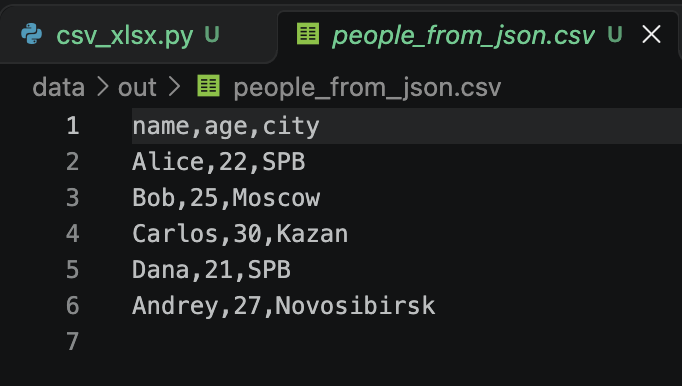
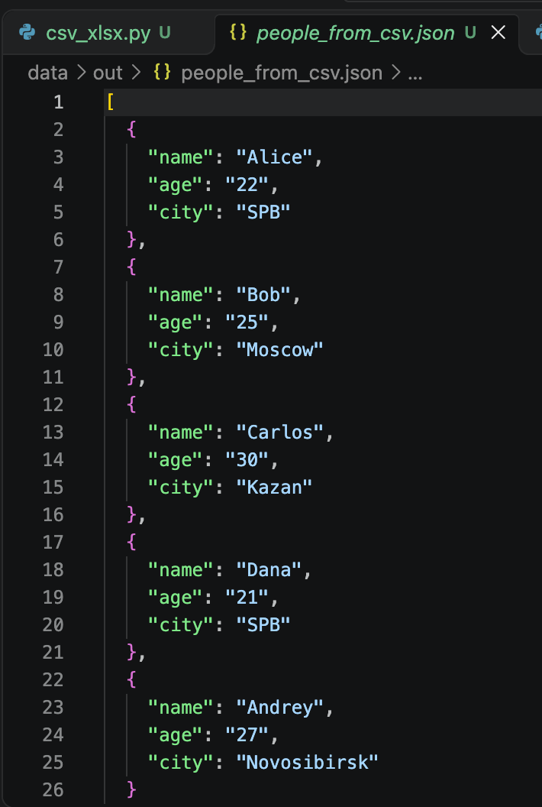
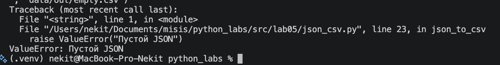
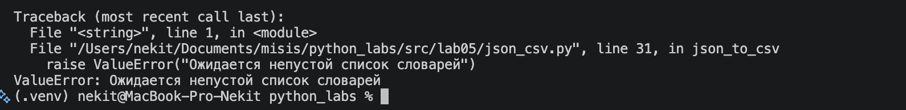
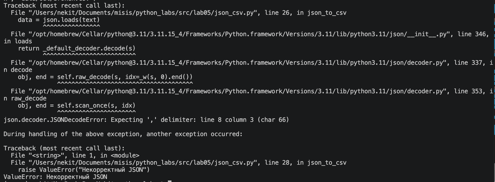
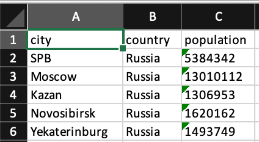

# python_labs

# Хохлов Никита

---

# Группа БИВТ-26-6-1

---

# Лабораторная работа №5

---

В работе используются форматы JSON, CSV и XLSX.

Программа преобразует JSON в CSV, CSV в JSON и CSV в XLSX.

Для работы используются модули `json`, `csv`, `pathlib` и библиотека `openpyxl`.

Также используются функции `read_text` и `write_csv` из лабораторной работы №4.

---


## Задание A

### `json_to_csv`

Преобразует JSON-файл со списком словарей в CSV.

Проверяет расширения файлов, наличие исходного файла и правильность структуры JSON.

Для чтения JSON используется функция `read_text` из лабораторной работы №4.

Для записи результата используется функция `write_csv` из той же лабораторной.

Программа собирает ключи из всех словарей и использует их как заголовки CSV.

Если какого-то поля нет, вместо него записывается пустая строка.

```python
def json_to_csv(json_path: str, csv_path: str) -> None:
    """Преобразует JSON со списком словарей в CSV."""
    json_file = Path(json_path)
    csv_file = Path(csv_path)

    if json_file.suffix.lower() != ".json" or csv_file.suffix.lower() != ".csv":
        raise ValueError("Неверное расширение файла")

    if not json_file.is_file():
        raise FileNotFoundError(f"Файл не найден: {json_path}")

    text = read_text(json_file)

    if not text.strip():
        raise ValueError("Пустой JSON")

    try:
        data = json.loads(text)
    except json.JSONDecodeError:
        raise ValueError("Некорректный JSON")

    if not isinstance(data, list) or not data:
        raise ValueError("Ожидается непустой список словарей")

    columns = []

    for item in data:
        if not isinstance(item, dict):
            raise ValueError("Ожидается список словарей")

        for key in item:
            if key not in columns:
                columns.append(key)

    if not columns:
        raise ValueError("JSON не содержит полей")

    rows = []

    for item in data:
        row = []

        for column in columns:
            row.append(item.get(column, ""))

        rows.append(row)

    write_csv(rows, csv_file, tuple(columns))
```

### Тестирование `json_to_csv`

Для проверки используется файл `data/samples/people.json`.

Программа преобразует его в `people_from_json.csv`.

Первая строка CSV содержит названия столбцов `name`, `age`, `city`.

Количество записей совпадает с исходным JSON — 5 человек.



---

### `csv_to_json`

Преобразует CSV-файл в JSON.

Проверяет расширения файлов и наличие исходного CSV.

Для чтения используется `csv.DictReader`.

Первая строка CSV становится заголовками, а остальные строки преобразуются в словари.

Все значения сохраняются как строки.

Для записи результата используется `json.dump` с параметрами `ensure_ascii=False` и `indent=2`.

```python
def csv_to_json(csv_path: str, json_path: str) -> None:
    """Преобразует CSV в JSON, сохраняя значения строками."""
    csv_file = Path(csv_path)
    json_file = Path(json_path)

    if csv_file.suffix.lower() != ".csv" or json_file.suffix.lower() != ".json":
        raise ValueError("Неверное расширение файла")

    if not csv_file.is_file():
        raise FileNotFoundError(f"Файл не найден: {csv_path}")

    with csv_file.open("r", newline="", encoding="utf-8") as file:
        reader = csv.DictReader(file)

        if not reader.fieldnames or "" in reader.fieldnames:
            raise ValueError("В CSV нет заголовка")

        if len(set(reader.fieldnames)) != len(reader.fieldnames):
            raise ValueError("Заголовки CSV повторяются")

        data = list(reader)

    if not data:
        raise ValueError("Пустой CSV или только заголовок")

    for row in data:
        if None in row:
            raise ValueError("В строке больше значений, чем заголовков")

        for key in row:
            if row[key] is None:
                row[key] = ""

    json_file.parent.mkdir(parents=True, exist_ok=True)

    with json_file.open("w", encoding="utf-8") as file:
        json.dump(data, file, ensure_ascii=False, indent=2)
```

### Тестирование `csv_to_json`

Для проверки используется файл `data/samples/people.csv`.

Программа создаёт файл `people_from_csv.json`.

Названия столбцов CSV становятся ключами словарей.

Количество объектов совпадает с количеством строк данных — 5.




---

### Использование функций из лабораторной №4

В файле `json_csv.py` используются функции из `src/lib/io_helpers.py`.

```python
from src.lib.io_helpers import read_text, write_csv
```

Функция `read_text` используется для чтения содержимого JSON.

```python
text = read_text(json_file)
```

Функция `write_csv` используется для записи данных в CSV.

```python
write_csv(rows, csv_file, tuple(columns))
```

Перед записью словари преобразуются в списки значений.

Это позволяет повторно использовать функции из предыдущей лабораторной работы.

---

### Проверка пустого JSON

Для проверки используется файл `data/samples/empty.json`, который не содержит данных.

Если файл пустой, возникает `ValueError`.

```python
if not text.strip():
    raise ValueError("Пустой JSON")
```

В результате возникает ошибка `ValueError: Пустой JSON`.



---

### Проверка неправильной структуры JSON

Для проверки используется файл `data/samples/broken.json`.

Он содержит один словарь вместо списка словарей.

```json
{
    "name": "Alice",
    "age": 22,
    "city": "SPB"
}
```

Программа проверяет структуру данных.

```python
if not isinstance(data, list) or not data:
    raise ValueError("Ожидается непустой список словарей")
```


В результате возникает ошибка `ValueError: Ожидается непустой список словарей`.



---

### Проверка некорректного JSON

Если JSON содержит синтаксическую ошибку, например пропущенную скобку, программа не может прочитать данные.

Для обработки используется `try` и `except`.

```python
try:
    data = json.loads(text)
except json.JSONDecodeError:
    raise ValueError("Некорректный JSON")
```

Для проверки в `broken.json` временно записывается JSON с нарушенным синтаксисом.

При запуске возникает ошибка `json.JSONDecodeError`, которая перехватывается программой и преобразуется в `ValueError`.

Итоговая ошибка — `ValueError: Некорректный JSON`.



---

## Задание B

### `csv_to_xlsx`

Преобразует CSV-файл в XLSX.

Для работы используется библиотека `openpyxl`.

Сначала программа проверяет расширения файлов и наличие исходного CSV.

Далее читает таблицу с помощью `csv.reader`.

Создаёт новую книгу Excel с листом `Sheet1`.

Все строки CSV переносятся в Excel.

Ширина столбцов устанавливается по самому длинному значению, но не менее 8 символов.

```python
def csv_to_xlsx(csv_path: str, xlsx_path: str) -> None:
    """Преобразует CSV в XLSX с автоматической шириной столбцов."""
    csv_file = Path(csv_path)
    xlsx_file = Path(xlsx_path)

    if csv_file.suffix.lower() != ".csv" or xlsx_file.suffix.lower() != ".xlsx":
        raise ValueError("Неверное расширение файла")

    if not csv_file.is_file():
        raise FileNotFoundError(f"Файл не найден: {csv_path}")

    with csv_file.open("r", newline="", encoding="utf-8") as file:
        rows = list(csv.reader(file))

    if len(rows) < 2 or not rows[0] or "" in rows[0]:
        raise ValueError("В CSV должны быть заголовки и данные")

    for row in rows:
        if len(row) != len(rows[0]):
            raise ValueError("Строки CSV разной длины")

    book = Workbook()
    sheet = book.active
    sheet.title = "Sheet1"

    for row in rows:
        sheet.append(row)

    for col in range(1, len(rows[0]) + 1):
        width = 8

        for row in rows:
            width = max(width, len(row[col - 1]))

        letter = get_column_letter(col)
        sheet.column_dimensions[letter].width = width

    xlsx_file.parent.mkdir(parents=True, exist_ok=True)
    book.save(xlsx_file)
```

### Тестирование `csv_to_xlsx`


Программа использует файл `data/samples/cities.csv` и создаёт `data/out/cities.xlsx`.

В Excel переносятся три столбца: `city`, `country`, `population`.

Все пять записей сохраняются.

Лист создаётся с названием `Sheet1`.



---

### Проверка автоматической ширины столбцов

Ширина каждого столбца определяется по максимальной длине значения в этом столбце.

```python
for col in range(1, len(rows[0]) + 1):
    width = 8

    for row in rows:
        width = max(width, len(row[col - 1]))

    letter = get_column_letter(col)
    sheet.column_dimensions[letter].width = width
```

`get_column_letter` преобразует номер столбца в букву Excel, например 1 в A, 2 в B.

Если самое длинное значение короче 8 символов, используется ширина 8.

Это позволяет отображать данные без ручного изменения ширины столбцов.

---

