# Лабораторная работа №6

**Хохлов Никита, БИВТ-26-6-1**

## 1. Работа с текстом — cli_text.py

В этом файле сделаны две команды: `cat` и `stats`. Для работы с аргументами используется `argparse`.

### Команда cat

Выводит содержимое файла в терминал. С помощью флага `-n` можно включить нумерацию строк.

**Тест 1. Вывод файла без нумерации**

```bash
python -m src.lab06.cli_text cat --input data/samples/people.csv
```

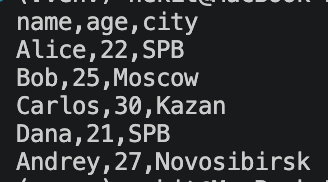

**Тест 2. Вывод файла с нумерацией**

```bash
python -m src.lab06.cli_text cat --input data/samples/people.csv -n
```

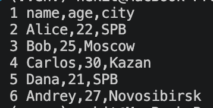

### Команда stats

Считает общее количество слов, количество уникальных слов и выводит самые частые слова. Используются функции из третьей лабораторной.

**Тест 3. Статистика с top по умолчанию**

По умолчанию выводится 5 самых частых слов.

```bash
python -m src.lab06.cli_text stats --input data/samples/lab06_words.txt
```

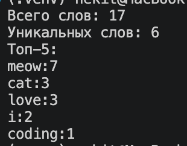

**Тест 4. Статистика с top 3**

```bash
python -m src.lab06.cli_text stats --input data/samples/lab06_words.txt --top 3
```

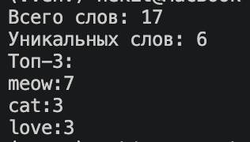

### Проверка ошибок cli_text

**Тест 5. Несуществующий файл**

Проверяем, как программа реагирует на отсутствие файла.

```bash
python -m src.lab06.cli_text cat --input data/samples/missing.txt
```

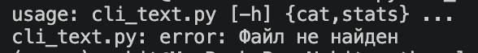

**Тест 6. Отрицательное значение top**

Значение `--top` должно быть больше нуля.

```bash
python -m src.lab06.cli_text stats --input data/samples/lab06_words.txt --top -3
```

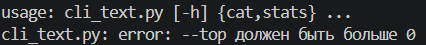

### Проверка справки cli_text

**Тест 7. Общая справка**

```bash
python -m src.lab06.cli_text --help
```

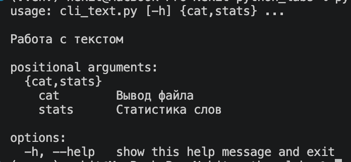

**Тест 8. Справка cat**

```bash
python -m src.lab06.cli_text cat --help
```

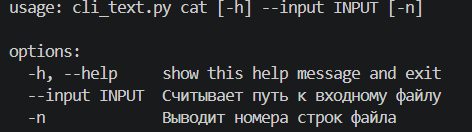

**Тест 9. Справка stats**

```bash
python -m src.lab06.cli_text stats --help
```

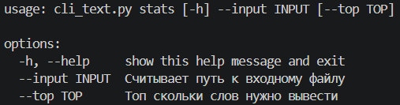

---

## 2. Конвертация файлов — cli_convert.py

Здесь реализованы три команды: `json2csv`, `csv2json` и `csv2xlsx`.

Для конвертации используются функции из пятой лабораторной.

Аргумент `--in` указывает исходный файл, а `--out` — путь для сохранения результата.

### Проверка конвертации

**Тест 10. JSON в CSV**

```bash
python -m src.lab06.cli_convert json2csv --in data/samples/people.json --out data/out/people_from_json.csv
```

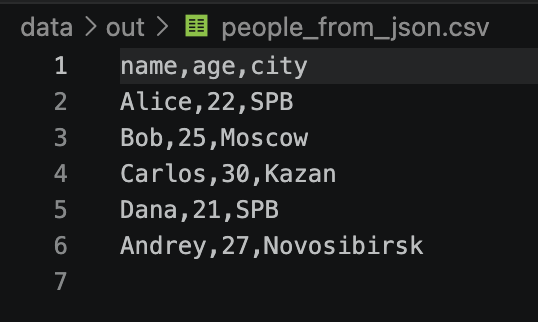

**Тест 11. CSV в JSON**

```bash
python -m src.lab06.cli_convert csv2json --in data/samples/people.csv --out data/out/people_from_csv.json
```

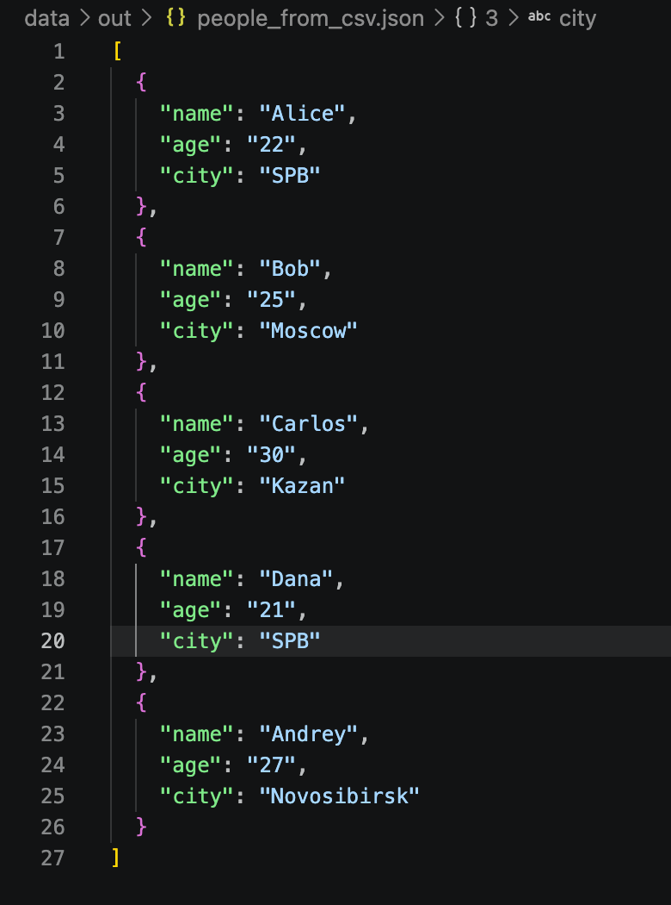

**Тест 12. CSV в XLSX**

```bash
python -m src.lab06.cli_convert csv2xlsx --in data/samples/people.csv --out data/out/people.xlsx
```

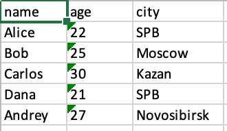

### Проверка ошибок cli_convert

**Тест 13. Запуск без обязательных аргументов**

Проверяем, что программа сообщает об отсутствии `--in` и `--out`.

```bash
python -m src.lab06.cli_convert json2csv
```

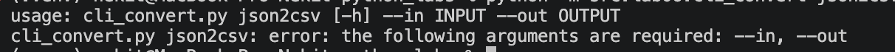

### Проверка справки cli_convert

**Тест 14. Общая справка**

```bash
python -m src.lab06.cli_convert --help
```

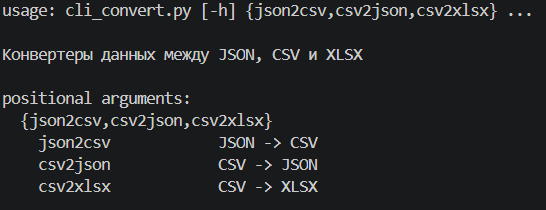

**Тест 15. Справка json2csv**

```bash
python -m src.lab06.cli_convert json2csv --help
```

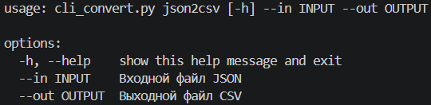

**Тест 16. Справка csv2json**

```bash
python -m src.lab06.cli_convert csv2json --help
```

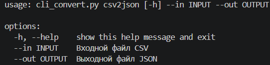

**Тест 17. Справка csv2xlsx**

```bash
python -m src.lab06.cli_convert csv2xlsx --help
```

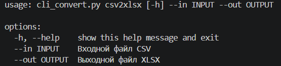
