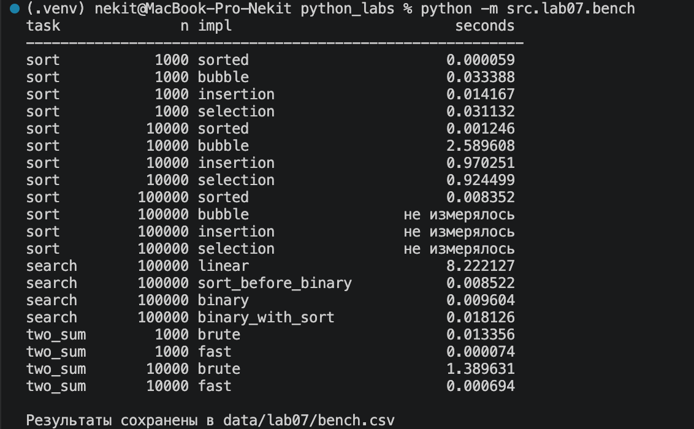
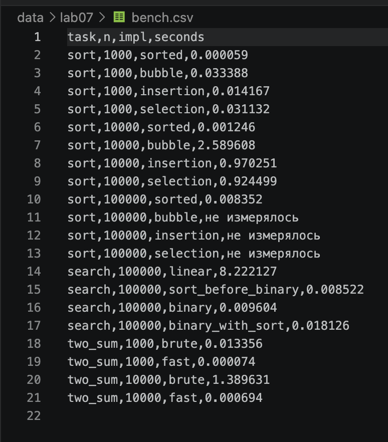

# python_labs

# Хохлов Никита

---

# Группа БИВТ-26-6-1

---

# Лабораторная работа №7

---

В лабораторной реализованы алгоритмы поиска и сортировки, проверена их правильность и измерено время выполнения на списках разного размера.

Работа состоит из четырёх файлов: `search.py`, `sorting.py`, `check.py`, `bench.py`.

**Запуск из корня репозитория:**

```bash
python -m src.lab07.check
python -m src.lab07.bench
```

## 1. Алгоритмы поиска (`search.py`)

### `linear_search`

Обычный линейный поиск. Проходим по списку по порядку, сравниваем элементы с `x` и возвращаем индекс первого совпадения. Если число не найдено, возвращаем `-1`. Список сортировать не нужно.

```python
def linear_search(nums, x):
    """Возвращает индекс первого x в списке или -1."""
    for i in range(len(nums)):
        if nums[i] == x:
            return i
    return -1
```

**Сложность:** `O(n)` в худшем случае; `O(1)`, если искомое число стоит первым.

### `binary_search`

Бинарный поиск подходит для списка, **отсортированного по возрастанию**. Сначала рассматриваем средний элемент. Если он меньше `x`, сдвигаем левую границу, если больше — правую. Так каждый раз исключаем примерно половину оставшихся элементов.

```python
def binary_search(sorted_nums, x):
    """Ищет x в отсортированном списке. Если x нет, возвращает -1.
    На неотсортированном списке результат не определён.
    """
    left = 0
    right = len(sorted_nums) - 1

    while left <= right:
        middle = (left + right) // 2
        if sorted_nums[middle] == x:
            return middle
        elif sorted_nums[middle] < x:
            left = middle + 1
        else:
            right = middle - 1

    return -1
```

**Сложность:** `O(log n)`. Сортировка, если она требуется перед поиском, в эту оценку не входит.

### `two_sum_brute`

Ищет два разных элемента, сумма которых равна `target`. Первый цикл выбирает индекс `i`, а второй перебирает индексы `j`, которые идут после него. Начинаем с `i + 1`, чтобы не использовать один элемент дважды и не проверять одну пару в обратном порядке.

```python
def two_sum_brute(nums, target):
    """Перебирает пары и возвращает их индексы или None."""
    for i in range(len(nums)):
        for j in range(i + 1, len(nums)):
            if nums[i] + nums[j] == target:
                return (i, j)
    return None
```

**Сложность:** `O(n²)` в худшем случае, так как число возможных пар равно `n(n - 1) / 2`.

### `two_sum_fast`

Вместо перебора всех пар используем словарь `seen`. В нём храним уже встреченные числа и их индексы. Для текущего элемента вычисляем `needed = target - nums[i]` и проверяем, есть ли такое число в словаре. Только после проверки записываем текущий элемент — так он не сможет образовать пару сам с собой.

```python
def two_sum_fast(nums, target):
    """Ищет пару за один проход с помощью словаря."""
    seen = {}

    for i in range(len(nums)):
        needed = target - nums[i]
        if needed in seen:
            return (seen[needed], i)
        seen[nums[i]] = i

    return None
```

**Сложность:** `O(n)` по времени в среднем и `O(n)` по дополнительной памяти. Поиск ключа в словаре Python в среднем выполняется за `O(1)`, поэтому второй вложенный цикл не требуется.

## 2. Сортировка (`sorting.py`)

Все функции сортируют числа по возрастанию и возвращают **новый** список. Строка `result = list(nums)` создаёт копию, поэтому входные данные не меняются. В самих алгоритмах не используются `sorted()`, `.sort()`, `min()` и `max()`.

### `bubble_sort`

Сортировка пузырьком сравнивает соседние элементы и меняет их местами, если они стоят неправильно. После каждого прохода большой элемент оказывается ближе к концу. Переменная `swapped` позволяет закончить работу раньше, если обменов не было.

```python
def bubble_sort(nums):
    """Сортировка пузырьком. Возвращает новый список."""
    result = list(nums)
    n = len(result)

    for i in range(n - 1):
        swapped = False
        for j in range(n - 1 - i):
            if result[j] > result[j + 1]:
                result[j], result[j + 1] = result[j + 1], result[j]
                swapped = True
        if not swapped:
            break

    return result
```

**Сложность:** `O(n²)` в среднем и худшем случае, `O(n)` на уже отсортированном списке.

### `insertion_sort`

Сортировка вставками начинает со второго элемента. Сохраняем его в `current`, сдвигаем большие элементы вправо и вставляем `current` на освободившееся место. Левая часть списка постепенно становится отсортированной.

```python
def insertion_sort(nums):
    """Сортировка вставками. Возвращает новый список."""
    result = list(nums)

    for i in range(1, len(result)):
        current = result[i]
        j = i - 1

        while j >= 0 and result[j] > current:
            result[j + 1] = result[j]
            j -= 1
        result[j + 1] = current

    return result
```

**Сложность:** `O(n²)` в среднем и худшем случае, `O(n)` на отсортированном списке.

### `selection_sort`

Сортировка выбором для каждой позиции ищет минимальный элемент среди ещё неотсортированных и переставляет его на текущую позицию. В `smallest` хранится индекс найденного минимума.

```python
def selection_sort(nums):
    """Сортировка выбором. Возвращает новый список."""
    result = list(nums)

    for i in range(len(result)):
        smallest = i
        for j in range(i + 1, len(result)):
            if result[j] < result[smallest]:
                smallest = j
        result[i], result[smallest] = result[smallest], result[i]

    return result
```

**Сложность:** `O(n²)` даже на отсортированном списке: поиск минимума выполняется на каждом шаге.

## 3. Проверка алгоритмов (`check.py`)

Тесты выполняются на случайных списках, а также на отдельных граничных случаях: пустой список, один элемент, повторяющиеся значения и отсутствие ответа. Для повторяемости используется `random.seed(42)`. Если условие в `assert` неверное, возникает ошибка с сообщением.

### `check_sorting`

Для каждой из трёх сортировок создаются 100 случайных списков длиной от 0 до 50. Результат сравнивается со встроенной `sorted()`, а также проверяется, что исходный список не изменился. Ещё четыре случая проверяются отдельно.

```python
def check_sorting(fn, trials=100):
    global checks
    for _ in range(trials):
        n = random.randint(0, 50)
        nums = [random.randint(-100, 100) for _ in range(n)]
        original = list(nums)

        assert fn(nums) == sorted(nums), f"Ошибка сортировки: {fn.__name__}, {nums}"
        assert nums == original, f"Изменился исходный список: {fn.__name__}, {nums}"
        checks += 1

    for nums in ([], [5], [2, 1], [3, 3, 1]):
        original = list(nums)
        assert fn(nums) == sorted(nums), f"Ошибка сортировки: {fn.__name__}, {nums}"
        assert nums == original, f"Изменился исходный список: {fn.__name__}, {nums}"
        checks += 1
```

### `check_search`

Линейный поиск сравнивается с `list.index()`. Если число отсутствует, вместо исключения `ValueError` ожидаем `-1`. Для бинарного поиска используем отсортированный список и проверяем, что по возвращённому индексу находится нужное значение. Отдельно проверяем первый и последний элементы.

```python
try:
    expected = nums.index(x)
except ValueError:
    expected = -1

assert linear_search(nums, x) == expected

ordered = sorted(nums)
index = binary_search(ordered, x)
if x in ordered:
    assert index != -1 and ordered[index] == x
else:
    assert index == -1
```

### `check_two_sum`

Сравниваются оба способа решения Two Sum. Алгоритмы могут вернуть разные пары, поэтому нельзя просто сравнивать их результаты через `==`. Проверяем, что оба согласны о наличии решения, и отдельно проверяем индексы и сумму.

```python
brute = two_sum_brute(nums, target)
fast = two_sum_fast(nums, target)

assert (brute is None) == (fast is None)
for pair in (brute, fast):
    if pair is not None:
        i, j = pair
        assert 0 <= i < j < len(nums) and nums[i] + nums[j] == target
```

### Результат проверки

Команда:

```bash
python -m src.lab07.check
```

Вывод:

```text
OK: 814 проверок
```

Все проверки в итоговом запуске пройдены успешно.

## 4. Измерение времени (`bench.py`)

Для замеров используется `timeit.timeit`. В функцию передаётся `lambda`, чтобы измеряемый алгоритм запускался внутри `timeit`. Результаты выводятся в терминал и сохраняются в файл `data/lab07/bench.csv`.

### `bench_sorts`

Сравнивает `sorted()` с пузырьковой сортировкой, сортировкой вставками и выбором на списках из 1 000, 10 000 и 100 000 элементов. Для всех алгоритмов одного размера используется один и тот же список.

```python
seconds = timeit.timeit(lambda: sorted(nums), number=1)
rows.append(("sort", n, "sorted", seconds))

for name, fn in (("bubble", bubble_sort),
                 ("insertion", insertion_sort),
                 ("selection", selection_sort)):
    if n == 100_000:
        rows.append(("sort", n, name, "не измерялось"))
    else:
        seconds = timeit.timeit(lambda: fn(nums), number=1)
        rows.append(("sort", n, name, seconds))
```

На 100 000 элементов квадратичные сортировки не запускались, чтобы не тратить слишком много времени. Это **пропущенные замеры**, а не результат `>60` секунд.

### `bench_search`

Создаёт список из 100 000 чисел и 10 000 запросов. Отдельно измеряется время линейного поиска, сортировки, бинарного поиска и сумма времени сортировки с бинарным поиском.

```python
sort_seconds = timeit.timeit(lambda: sorted(nums), number=1)
ordered = sorted(nums)

def run_binary():
    for x in queries:
        binary_search(ordered, x)

seconds = timeit.timeit(run_binary, number=1)
rows.append(("search", 100_000, "sort_before_binary", sort_seconds))
rows.append(("search", 100_000, "binary", seconds))
rows.append(("search", 100_000, "binary_with_sort", sort_seconds + seconds))
```

Это позволяет сравнить не только сам поиск, но и стоимость предварительной подготовки данных.

### `bench_two_sum`

Сравнивает `two_sum_brute` и `two_sum_fast` на списках из 1 000 и 10 000 элементов. Для замера подходящую пару помещаем в конец списка, чтобы полный перебор успел выполнить много проверок.

```python
nums = [random.randint(1, 100_000) for _ in range(n - 2)]
nums += [500_000, 500_001]
target = 1_000_001

seconds = timeit.timeit(lambda: two_sum_brute(nums, target), number=1)
rows.append(("two_sum", n, "brute", seconds))

seconds = timeit.timeit(lambda: two_sum_fast(nums, target), number=1)
rows.append(("two_sum", n, "fast", seconds))
```

### `main` и сохранение данных

`main()` последовательно вызывает все замеры. Результаты собираются в список `rows`, форматируются до шести знаков после точки и записываются в CSV. Для создания папки используется `Path(...).mkdir(...)`.

```python
Path("data/lab07").mkdir(parents=True, exist_ok=True)
write_csv(csv_rows, "data/lab07/bench.csv", header=("task", "n", "impl", "seconds"))
```

### Результаты замеров

Команда запуска:

```bash
python -m src.lab07.bench
```

Результаты моего запуска (секунды):

| Задача | n | Алгоритм | Время, с |
|---|---:|---|---:|
| sort | 1 000 | `sorted` | 0.000059 |
| sort | 1 000 | `bubble` | 0.033388 |
| sort | 1 000 | `insertion` | 0.014167 |
| sort | 1 000 | `selection` | 0.031132 |
| sort | 10 000 | `sorted` | 0.001246 |
| sort | 10 000 | `bubble` | 2.589608 |
| sort | 10 000 | `insertion` | 0.970251 |
| sort | 10 000 | `selection` | 0.924499 |
| sort | 100 000 | `sorted` | 0.008352 |
| sort | 100 000 | `bubble` | не измерялось |
| sort | 100 000 | `insertion` | не измерялось |
| sort | 100 000 | `selection` | не измерялось |
| search | 100 000 | `linear` | 8.222127 |
| search | 100 000 | `sort_before_binary` | 0.008522 |
| search | 100 000 | `binary` | 0.009604 |
| search | 100 000 | `binary_with_sort` | 0.018126 |
| two_sum | 1 000 | `brute` | 0.013356 |
| two_sum | 1 000 | `fast` | 0.000074 |
| two_sum | 10 000 | `brute` | 1.389631 |
| two_sum | 10 000 | `fast` | 0.000694 |

Полученные значения зависят от компьютера и нагрузки во время запуска.

## 5. Выводы

### Сравнение сортировок

При увеличении списка с 1 000 до 10 000 элементов время пузырьковой сортировки выросло с **0.033388 с** до **2.589608 с** (примерно в **78 раз**). Сортировка вставками замедлилась примерно в **69 раз**, а выбором — в **30 раз**. Точные коэффициенты могут отличаться из-за накладных расходов и особенностей данных, но все три алгоритма имеют квадратичную сложность `O(n²)` в среднем или худшем случае.

Встроенная `sorted()` работает заметно быстрее: для 10 000 элементов **0.001246 с** против **2.589608 с** у пузырька, то есть более чем в **2 000 раз** быстрее. Её сложность — `O(n log n)`.

### Линейный и бинарный поиск

Линейному поиску в худшем случае нужно просмотреть весь список (`O(n)`), а бинарный каждый раз сокращает область поиска вдвое (`O(log n)`). Но бинарному нужен заранее отсортированный список.

В моём замере 10 000 линейных поисков заняли **8.222127 с**. Бинарные поиски заняли **0.009604 с**, а вместе с сортировкой — **0.018126 с**. Даже с учётом подготовки это примерно в **454 раза** быстрее. Если поисковых запросов много, сортировка окупается.

### Два решения Two Sum

`two_sum_brute` перебирает возможные пары двумя вложенными циклами (`O(n²)`). `two_sum_fast` запоминает уже просмотренные значения в словаре: благодаря средней сложности поиска ключа `O(1)` весь алгоритм работает за `O(n)` в среднем, но использует дополнительную память `O(n)`.

На 10 000 элементов обычный перебор занял **1.389631 с**, а вариант со словарём — **0.000694 с**. Разница составила примерно **2 000 раз**.

### Что показал `check.py`

Автоматические тесты проверили сортировки, оба поиска и оба варианта Two Sum. В итоговом запуске прошло **814 проверок**, ошибок не обнаружено. Особенно полезны проверки на пустых списках, повторах и отсутствии подходящего значения.

## 6. Скриншоты

После запуска можно добавить в папку `images/lab07/` скриншоты терминала и CSV-файла. Тогда в README появятся изображения:





