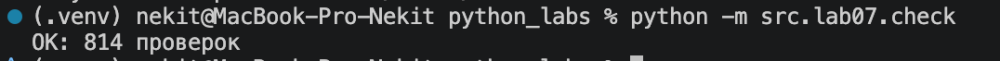

# python_labs

# Хохлов Никита

---

# Группа БИВТ-26-6-1

---

# Лабораторная работа №7

---

## Задание A. Алгоритмы поиска

### search.py

```python
def linear_search(nums, x):
    """Возвращает индекс первого x в списке или -1."""
    for i in range(len(nums)):
        if nums[i] == x:
            return i
    return -1


def binary_search(sorted_nums, x):
    """Ищет x в отсортированном списке. Если x нет, возвращает -1.
    На неотсортированном списке результат не определён.
    """
    left = 0
    right = len(sorted_nums) - 1

    while left <= right:
        middle = (left + right) // 2
        if sorted_nums[middle] == x:
            return middle
        elif sorted_nums[middle] < x:
            left = middle + 1
        else:
            right = middle - 1

    return -1


def two_sum_brute(nums, target):
    """Перебирает пары и возвращает их индексы или None."""
    for i in range(len(nums)):
        for j in range(i + 1, len(nums)):
            if nums[i] + nums[j] == target:
                return (i, j)
    return None


def two_sum_fast(nums, target):
    """Ищет пару за один проход с помощью словаря."""
    seen = {}

    for i in range(len(nums)):
        needed = target - nums[i]
        if needed in seen:
            return (seen[needed], i)
        seen[nums[i]] = i

    return None
```

**Описание функций:**

1. **linear_search** — линейный поиск. Последовательно перебираем элементы списка и сравниваем их с искомым значением `x`. Если нашли совпадение, возвращаем индекс первого подходящего элемента. Если число отсутствует, возвращаем `-1`. Сложность в худшем случае `O(n)`, так как может потребоваться проверить весь список. Дополнительная память `O(1)`.

2. **binary_search** — бинарный поиск. Работает только с отсортированным по возрастанию списком. Сначала задаём левую и правую границы поиска, затем вычисляем средний индекс. Если средний элемент меньше искомого, сдвигаем левую границу вправо, иначе — правую влево. На каждом шаге область поиска уменьшается примерно вдвое. Сложность `O(log n)`, дополнительная память `O(1)`.

3. **two_sum_brute** — поиск двух элементов с суммой `target` полным перебором. Используем два вложенных цикла. Первый выбирает индекс `i`, второй перебирает элементы после него. Начинаем с `i + 1`, чтобы не использовать один элемент дважды и не проверять повторно одни и те же пары. Если сумма совпала, возвращаем кортеж индексов `(i, j)`. Сложность в худшем случае `O(n²)`, память `O(1)`.

4. **two_sum_fast** — более быстрый вариант поиска пары. Вместо двух вложенных циклов используем словарь `seen`, в котором храним уже просмотренные числа и их индексы. Для каждого элемента вычисляем `needed = target - nums[i]` и проверяем наличие этого числа в словаре. Если число найдено, возвращаем индексы пары. Поиск ключа в словаре в среднем занимает `O(1)`, поэтому общая средняя сложность `O(n)`. Дополнительная память `O(n)`.

В первом Two Sum проверяем возможные пары перебором, а во втором используем хеш-таблицу, что позволяет значительно сократить время поиска.

---

## Задание B. Алгоритмы сортировки

### sorting.py

```python
def bubble_sort(nums):
    """Сортировка пузырьком. Возвращает новый список."""
    result = list(nums)
    n = len(result)

    for i in range(n - 1):
        swapped = False
        for j in range(n - 1 - i):
            if result[j] > result[j + 1]:
                result[j], result[j + 1] = result[j + 1], result[j]
                swapped = True
        if not swapped:
            break

    return result


def insertion_sort(nums):
    """Сортировка вставками. Возвращает новый список."""
    result = list(nums)

    for i in range(1, len(result)):
        current = result[i]
        j = i - 1

        while j >= 0 and result[j] > current:
            result[j + 1] = result[j]
            j -= 1
        result[j + 1] = current

    return result


def selection_sort(nums):
    """Сортировка выбором. Возвращает новый список."""
    result = list(nums)

    for i in range(len(result)):
        smallest = i
        for j in range(i + 1, len(result)):
            if result[j] < result[smallest]:
                smallest = j
        result[i], result[smallest] = result[smallest], result[i]

    return result
```

Во всех трёх функциях используется `result = list(nums)`. Так мы создаём копию исходного списка и сортируем её, не изменяя переданные данные.

**Описание функций:**

1. **bubble_sort** — пузырьковая сортировка. Сравниваем соседние элементы и меняем их местами, если левый больше правого. После каждого прохода один из наибольших элементов оказывается на правильной позиции. Диапазон внутреннего цикла постепенно сокращается, так как конец списка уже отсортирован. Переменная `swapped` показывает, были ли перестановки. Если их не было, сортировка заканчивается досрочно. Сложность `O(n²)` в среднем и худшем случае, `O(n)` для уже отсортированного списка.

2. **insertion_sort** — сортировка вставками. Начинаем со второго элемента, сохраняем его в переменную `current` и сравниваем с предыдущими элементами. Пока они больше текущего, сдвигаем их вправо. После этого вставляем сохранённый элемент на освободившуюся позицию. Сложность `O(n²)` в среднем и худшем случае, `O(n)` для уже отсортированного списка.

3. **selection_sort** — сортировка выбором. На каждом проходе ищем минимальный элемент в неотсортированной части списка. Его индекс сохраняем в `smallest`, после чего меняем найденный элемент с элементом на текущей позиции `i`. Повторяем, пока список не будет отсортирован. Сложность `O(n²)` даже для отсортированного списка, потому что поиск минимума выполняется на каждом проходе.

Все три алгоритма возвращают новый список. Дополнительная память каждой реализации составляет `O(n)` из-за копирования входных данных.

Пустые списки и списки из одного элемента обрабатываются корректно, так как ненужные циклы не выполняются.

---

## Задание C. Проверка алгоритмов

### check.py

```python
import random

from src.lab07.search import linear_search, binary_search, two_sum_brute, two_sum_fast
from src.lab07.sorting import bubble_sort, insertion_sort, selection_sort

checks = 0


def check_sorting(fn, trials=100):
    """Сравнивает сортировку с sorted и проверяет исходный список."""
    global checks

    for _ in range(trials):
        n = random.randint(0, 50)
        nums = [random.randint(-100, 100) for _ in range(n)]
        original = list(nums)

        assert fn(nums) == sorted(nums), f"Ошибка сортировки: {fn.__name__}, {nums}"
        assert nums == original, f"Изменился исходный список: {fn.__name__}, {nums}"
        checks += 1

    for nums in ([], [5], [2, 1], [3, 3, 1]):
        original = list(nums)
        assert fn(nums) == sorted(nums), f"Ошибка сортировки: {fn.__name__}, {nums}"
        assert nums == original, f"Изменился исходный список: {fn.__name__}, {nums}"
        checks += 1


def check_search():
    """Проверяет линейный и бинарный поиск на случайных списках."""
    global checks

    for _ in range(100):
        n = random.randint(0, 50)
        nums = [random.randint(-20, 20) for _ in range(n)]
        x = random.randint(-25, 25)

        try:
            expected = nums.index(x)
        except ValueError:
            expected = -1

        assert linear_search(nums, x) == expected, f"Ошибка linear_search: {nums}, x={x}"
        checks += 1

        ordered = sorted(nums)
        index = binary_search(ordered, x)

        if x in ordered:
            assert index != -1 and ordered[index] == x, f"Ошибка binary_search: {ordered}, x={x}"
        else:
            assert index == -1, f"Ошибка binary_search: {ordered}, x={x}"
        checks += 1

        if ordered:
            for edge in (ordered[0], ordered[-1]):
                index = binary_search(ordered, edge)
                assert index != -1 and ordered[index] == edge, f"Не найден крайний элемент: {ordered}"
                checks += 1

    assert linear_search([], 5) == -1
    assert binary_search([], 5) == -1
    assert binary_search([5], 5) == 0
    assert binary_search([1, 3], 2) == -1
    checks += 4


def check_two_sum(trials=100):
    """Проверяет, что оба способа находят правильную пару или None."""
    global checks

    for _ in range(trials):
        n = random.randint(0, 30)
        nums = [random.randint(-50, 50) for _ in range(n)]
        target = random.randint(-100, 100)

        brute = two_sum_brute(nums, target)
        fast = two_sum_fast(nums, target)

        assert (brute is None) == (fast is None), f"Разные результаты: {nums}, {target}"

        for pair in (brute, fast):
            if pair is not None:
                i, j = pair
                assert 0 <= i < j < len(nums) and nums[i] + nums[j] == target, (
                    f"Неверная пара: {nums}, {target}, {pair}"
                )
        checks += 1

    for nums, target in (([2, 7, 11, 15], 9), ([3, 3], 6), ([1, 2], 10), ([], 0)):
        brute = two_sum_brute(nums, target)
        fast = two_sum_fast(nums, target)

        assert (brute is None) == (fast is None)

        for pair in (brute, fast):
            if pair is not None:
                i, j = pair
                assert 0 <= i < j < len(nums) and nums[i] + nums[j] == target
        checks += 1


def main():
    random.seed(42)

    for fn in (bubble_sort, insertion_sort, selection_sort):
        check_sorting(fn)

    check_search()
    check_two_sum()

    print(f"OK: {checks} проверок")


if __name__ == "__main__":
    main()
```

**Описание проверок:**

1. **check_sorting** — для каждой сортировки создаём 100 случайных списков длиной от 0 до 50 с числами от −100 до 100. Результат работы функции сравниваем со встроенной `sorted()`. Дополнительно проверяем, что исходный список не изменился. Также выполняем четыре отдельных теста для пустого списка, одного элемента, обратного порядка и повторяющихся чисел.

2. **check_search** — проверяем линейный поиск через встроенный `list.index()`. Поскольку при отсутствии элемента `index()` вызывает `ValueError`, обрабатываем исключение и используем `-1` как ожидаемый результат. Бинарный поиск проверяем на отсортированном списке: если элемент есть, проверяем правильность найденного индекса, если нет — ожидаем `-1`. Также отдельно проверяем первый и последний элементы.

3. **check_two_sum** — проверяем оба варианта поиска пары. Алгоритмы могут вернуть разные пары с одинаковой суммой, поэтому сравниваем не сами результаты, а факт существования решения. Затем отдельно проверяем правильность индексов и суммы. Дополнительно используем четыре заранее заданных случая, включая повторяющиеся значения, отсутствие решения и пустой список.

4. **main** — запускает все проверки. `random.seed(42)` фиксирует последовательность случайных чисел, чтобы тесты можно было воспроизвести. Счётчик `checks` увеличивается после успешных тестовых случаев. При ошибке срабатывает `assert` и программа выводит сообщение.

### Результат работы check.py

Команда запуска:

```bash
python -m src.lab07.check
```

Результат:

```text
OK: 814 проверок
```

Все проверки успешно пройдены, ошибок не обнаружено.



---

## Задание D. Измерение времени

### bench.py

```python
import random
import timeit
from pathlib import Path

from src.lab04.io_txt_csv import write_csv
from src.lab07.search import linear_search, binary_search, two_sum_brute, two_sum_fast
from src.lab07.sorting import bubble_sort, insertion_sort, selection_sort


def make_data(n):
    """Создаёт список случайных чисел."""
    return [random.randint(0, n * 10) for _ in range(n)]


def bench_sorts(n):
    """Измеряет время разных сортировок на одном списке."""
    nums = make_data(n)
    rows = []

    seconds = timeit.timeit(lambda: sorted(nums), number=1)
    rows.append(("sort", n, "sorted", seconds))

    for name, fn in (("bubble", bubble_sort),
                     ("insertion", insertion_sort),
                     ("selection", selection_sort)):
        if n == 100_000:
            rows.append(("sort", n, name, "не измерялось"))
        else:
            seconds = timeit.timeit(lambda: fn(nums), number=1)
            rows.append(("sort", n, name, seconds))

    return rows


def bench_search():
    """Сравнивает 10 000 поисков в списке из 100 000 элементов."""
    nums = make_data(100_000)
    queries = [random.choice(nums) for _ in range(10_000)]
    rows = []

    def run_linear():
        for x in queries:
            linear_search(nums, x)

    seconds = timeit.timeit(run_linear, number=1)
    rows.append(("search", 100_000, "linear", seconds))

    sort_seconds = timeit.timeit(lambda: sorted(nums), number=1)
    ordered = sorted(nums)

    def run_binary():
        for x in queries:
            binary_search(ordered, x)

    seconds = timeit.timeit(run_binary, number=1)

    rows.append(("search", 100_000, "sort_before_binary", sort_seconds))
    rows.append(("search", 100_000, "binary", seconds))
    rows.append(("search", 100_000, "binary_with_sort", sort_seconds + seconds))

    return rows


def bench_two_sum(n):
    """Сравнивает поиск пары двумя способами."""
    nums = [random.randint(1, 100_000) for _ in range(n - 2)]
    nums += [500_000, 500_001]
    target = 1_000_001
    rows = []

    seconds = timeit.timeit(lambda: two_sum_brute(nums, target), number=1)
    rows.append(("two_sum", n, "brute", seconds))

    seconds = timeit.timeit(lambda: two_sum_fast(nums, target), number=1)
    rows.append(("two_sum", n, "fast", seconds))

    return rows


def print_table(rows):
    print(f"{'task':<10} {'n':>8} {'impl':<20} {'seconds':>16}")
    print("-" * 58)

    for task, n, impl, seconds in rows:
        if isinstance(seconds, float):
            seconds = f"{seconds:.6f}"
        print(f"{task:<10} {n:>8} {impl:<20} {seconds:>16}")


def main():
    random.seed(42)
    rows = []

    for n in (1_000, 10_000, 100_000):
        rows += bench_sorts(n)

    rows += bench_search()

    for n in (1_000, 10_000):
        rows += bench_two_sum(n)

    print_table(rows)

    Path("data/lab07").mkdir(parents=True, exist_ok=True)

    csv_rows = []

    for task, n, impl, seconds in rows:
        if isinstance(seconds, float):
            seconds = f"{seconds:.6f}"
        csv_rows.append((task, n, impl, seconds))

    write_csv(
        csv_rows,
        "data/lab07/bench.csv",
        header=("task", "n", "impl", "seconds")
    )

    print("\nРезультаты сохранены в data/lab07/bench.csv")


if __name__ == "__main__":
    main()
```

**Описание функций:**

1. **make_data** — создаёт список из `n` случайных чисел. Значения выбираются в диапазоне от 0 до `n * 10`. Список используется для измерения скорости алгоритмов.

2. **bench_sorts** — сравнивает встроенную сортировку `sorted()` с тремя реализованными алгоритмами. Используем `timeit.timeit()` для измерения времени одного запуска. Для одного размера все сортировки получают одинаковый список. Проверяем размеры 1 000, 10 000 и 100 000. На 100 000 элементов собственные сортировки пропускаем из-за квадратичной сложности, в таблице указываем «не измерялось».

3. **bench_search** — сравнивает линейный и бинарный поиск. Создаём список из 100 000 элементов и 10 000 запросов. Значения запросов выбираются из исходного списка, поэтому они гарантированно присутствуют. Для линейного поиска измеряем время всех запросов. Для бинарного отдельно учитываем время предварительной сортировки, время самих поисков и их сумму.

4. **bench_two_sum** — сравнивает два способа поиска пары на 1 000 и 10 000 элементах. Случайные числа дополняем двумя значениями в конце списка, сумма которых равна `target`. Это создаёт сложный случай для полного перебора, потому что подходящая пара расположена в конце. Оба алгоритма получают одинаковые данные.

5. **print_table** — выводит результаты измерений в виде таблицы. Через форматирование f-строк задаём ширину столбцов и выравнивание. Числовые значения времени округляем до шести знаков после точки.

6. **main** — последовательно запускает все измерения, объединяет результаты в список `rows`, выводит таблицу и сохраняет данные в `data/lab07/bench.csv`. Для записи используем `write_csv` из четвёртой лабораторной. Если папка отсутствует, создаём её через `Path(...).mkdir()`.

Для измерения времени используется `timeit.timeit(..., number=1)`. Параметр `number=1` означает один запуск переданной функции. `lambda` позволяет передать запуск алгоритма внутрь измерения времени.

В `bench_search` один запуск `run_linear()` или `run_binary()` включает сразу 10 000 поисковых запросов.

### Результат работы bench.py

Команда запуска:

```bash
python -m src.lab07.bench
```

Результаты замеров в секундах:

| Задача | n | Алгоритм | Время, с |
|---|---:|---|---:|
| sort | 1 000 | `sorted` | 0.000059 |
| sort | 1 000 | `bubble` | 0.033388 |
| sort | 1 000 | `insertion` | 0.014167 |
| sort | 1 000 | `selection` | 0.031132 |
| sort | 10 000 | `sorted` | 0.001246 |
| sort | 10 000 | `bubble` | 2.589608 |
| sort | 10 000 | `insertion` | 0.970251 |
| sort | 10 000 | `selection` | 0.924499 |
| sort | 100 000 | `sorted` | 0.008352 |
| sort | 100 000 | `bubble` | не измерялось |
| sort | 100 000 | `insertion` | не измерялось |
| sort | 100 000 | `selection` | не измерялось |
| search | 100 000 | `linear` | 8.222127 |
| search | 100 000 | `sort_before_binary` | 0.008522 |
| search | 100 000 | `binary` | 0.009604 |
| search | 100 000 | `binary_with_sort` | 0.018126 |
| two_sum | 1 000 | `brute` | 0.013356 |
| two_sum | 1 000 | `fast` | 0.000074 |
| two_sum | 10 000 | `brute` | 1.389631 |
| two_sum | 10 000 | `fast` | 0.000694 |

Все значения получены при запуске программы. На другом компьютере результаты могут отличаться.

На 100 000 элементов квадратичные сортировки не измерялись, поэтому в таблице указаны пропущенные замеры, а не предполагаемое время выполнения.

### Результаты в CSV

После запуска программа создаёт файл `data/lab07/bench.csv`, в котором сохраняются названия задач, размеры списков, названия алгоритмов и измеренное время.


### Вывод бенчмарка в консоль


---

## Вывод

В ходе лабораторной работы были реализованы алгоритмы линейного и бинарного поиска, два варианта Two Sum, а также три способа сортировки. Их правильность проверена на случайных данных и отдельных граничных случаях. Всего `check.py` выполнил 814 учтённых проверок, ошибок не обнаружено.

**Сортировки.** Пузырьковая сортировка имеет сложность `O(n²)` в среднем и худшем случае. При увеличении количества элементов с 1 000 до 10 000 время выполнения выросло с 0.033388 до 2.589608 секунды, примерно в 78 раз. Сортировка вставками и выбором тоже имеют квадратичную сложность в худшем случае, поэтому при увеличении списка работают значительно медленнее.

Встроенная функция `sorted()` использует алгоритм Timsort со сложностью `O(n log n)` в худшем случае. На 10 000 элементов она выполнилась за 0.001246 секунды, тогда как пузырьковая сортировка заняла 2.589608 секунды. Разница составила примерно 2078 раз.

**Поиск.** Линейный поиск имеет сложность `O(n)`, поскольку в худшем случае проверяет весь список. Бинарный поиск работает за `O(log n)`, так как каждый раз уменьшает область поиска примерно вдвое. При этом бинарному поиску требуется предварительно отсортированный список.

В измерениях 10 000 линейных поисков заняли 8.222127 секунды. Бинарный поиск вместе с предварительной сортировкой занял 0.018126 секунды. Получилось примерно в 454 раза быстрее. Таким образом, при многократном поиске по одним и тем же данным предварительная сортировка может быть выгодной.

**Two Sum.** Первый вариант использует два вложенных цикла и имеет худшую сложность `O(n²)`. Второй использует словарь, в котором поиск ключа в среднем выполняется за `O(1)`, поэтому общая средняя сложность алгоритма составляет `O(n)`.

На списке из 10 000 элементов обычный перебор занял 1.389631 секунды, а поиск через словарь — 0.000694 секунды. Разница составила примерно 2002 раза. При этом быстрый способ требует дополнительной памяти `O(n)` для хранения элементов в словаре.

Таким образом, результаты измерений показали, что выбор алгоритма существенно влияет на скорость выполнения программы, особенно при увеличении объёма входных данных.
